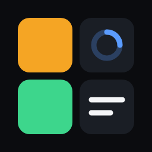
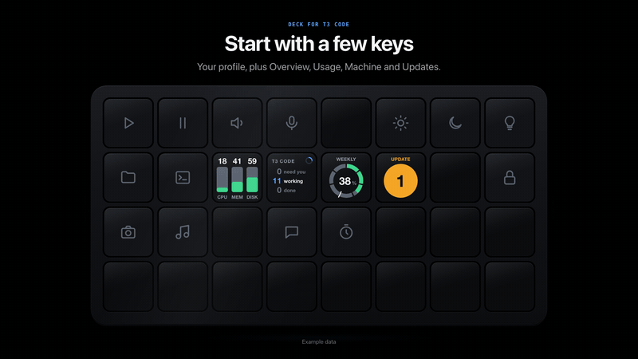

<div align="center">

<br>

<a href="https://hsalazr.github.io/deck-for-t3code/"></a>

# Deck for T3 Code

**Every [T3 Code](https://t3.codes) thread on a Stream Deck key.**<br>
See who's working, who needs you, who's done. Glance, tap, move on.

[](https://github.com/hsalazr/deck-for-t3code/actions/workflows/ci.yml)
[](https://github.com/hsalazr/deck-for-t3code/releases/latest)
[](https://github.com/hsalazr/deck-for-t3code/releases)
[](LICENSE)
[](#requirements)
[](#requirements)
[](https://github.com/hsalazr/deck-for-t3code/stargazers)
[](https://github.com/sponsors/hsalazr)

<h3><a href="https://hsalazr.github.io/deck-for-t3code/">hsalazr.github.io/deck-for-t3code</a></h3>

<br>



<br>

**macOS only.** Needs [T3 Code](https://t3.codes) installed and running on the same Mac.

[Website](https://hsalazr.github.io/deck-for-t3code/) · [Download](https://github.com/hsalazr/deck-for-t3code/releases/latest) · [Report a bug](https://github.com/hsalazr/deck-for-t3code/issues) · [Discussions](https://github.com/hsalazr/deck-for-t3code/discussions) · [Sponsor](https://github.com/sponsors/hsalazr)

<sub>Not affiliated with or endorsed by T3 Tools Inc. T3 Code is a trademark of its respective owner.</sub>

<br>
<br>

</div>

## Features

- **Live thread keys.** Colour, a glyph (`!` `✕` `✓`) and motion tell you the state before you read the title.
- **Subagents folded in.** They never take a key of their own. A badge counts them, and a waiting subagent makes the main key flash.
- **Overview key.** Counts of threads that need you, are working, or are done. One tile, one state.
- **T3 Threads page.** Press Overview to fill the whole deck with Thread keys. A Back key returns you to your previous profile.
- **Thread Actions page.** Hold a thread key, then let go, to send a quick message, compact the context, snooze, settle or stop the thread.
- **Usage keys.** Any usage limit T3 Code reports, as a bar or a ring, with a tick at even pace.
- **Machine keys.** This Mac's CPU (performance and efficiency cores apart), memory pressure and free disk space, together on one key or one per key.
- **Updates key.** Whether T3 Code or a provider CLI (Claude, Codex…) has an update waiting.
- **Context bar.** A thin bar along the bottom edge shows how full the thread's context window is.
- **Your other machines too.** With T3 Code's **Linked environments** (Settings → Labs) turned on, threads on your linked machines show up alongside this Mac's.
- **Private.** Talks only to T3 Code on your Mac. No account, no telemetry.

## Requirements

- macOS 13 or later (macOS only)
- Stream Deck app 7.1 or later
- T3 Code, installed and running, with its command-line tool at `<T3 home>/bin/t3`, `~/.t3/bin/t3` by default (T3 Code installs it)
- Any Stream Deck with keys. The bundled T3 Threads and Thread Actions pages cover the **Stream Deck XL**, the 15-key **Stream Deck** (including MK.2), the **Stream Deck Neo** and the **Stream Deck Mini**. Other models, such as the **Stream Deck +**, get the Thread, Overview, Usage, Machine and Updates keys but no bundled pages (details [below](#supported-decks)).

## Install

**From the Stream Deck Marketplace:** coming soon. For now, use a release.

**From a release:** download the `.streamDeckPlugin` file from [GitHub Releases](https://github.com/hsalazr/deck-for-t3code/releases) and double-click it.

To check a download was built by this repo's release workflow, run `gh attestation verify <file> --repo hsalazr/deck-for-t3code` (needs the [GitHub CLI](https://cli.github.com)), or compare its SHA-256 with `SHA256SUMS.txt` on the same release (`shasum -a 256 <file>`).

**Nightly:** the [`nightly` pre-release](https://github.com/hsalazr/deck-for-t3code/releases/tag/nightly) is rebuilt from `main` whenever new plugin code lands there, so fixes land there before the next release. It installs over the stable plugin (same keys and settings) and has the higher version (`1.0.0.N` after `1.0.0`); install a stable release over it to go back. It has passed CI, nothing more.

**From source** (Node 24):

```sh
git clone https://github.com/hsalazr/deck-for-t3code.git
cd deck-for-t3code
npm ci
npm run build
npx streamdeck link *.sdPlugin
```

Then drag **Overview**, **Thread** and **Usage** keys from the *Deck for T3 Code* category onto your deck. There is nothing to pair: on first run the plugin asks your local `t3` CLI for its own tokens (two read-only ones; see [Privacy & security](#privacy--security)).

## Using the keys

| Key | Means |
|---|---|
| Amber, blinking, `!` | The thread is waiting on you: an approval, a question, a secret or a link request. A subagent waiting on you counts too. |
| Red, blinking, `✕` | The latest run failed and you haven't looked at it yet. |
| Solid green, `✓` | A run finished while the plugin was watching and you haven't opened the thread yet. It doesn't blink. |
| Blue spinner (top-right corner) | The agent, or one of its subagents, is running. A badge counts subagents and background tasks. |
| White spinner and a chip | The turn ended, but background work is still running: subagents, commands, monitors, or a pull request's CI while it runs. The chip says what: `PR #42 CI`, `2 agents`, a command's name, `3 tasks`. |
| Dashed border, dimmed, `USAGE LIMIT` / `back in 2h 10m` | A usage limit paused the thread. The countdown updates every minute. |
| Plain dark key | Nothing happening. Shown for the "Show idle for" time after the last update. |

A thin bar along the bottom edge shows context use: grey, amber from 70%, red from 85%. When no subagents or background work take the corner of the footer, the percentage shows next to the project name.

Only the states that need you blink: needs you (amber, about once a second) and failed (red, a little slower). With **Animation: Off** they turn into a steady tinted key with a ring, and the spinners stop.

**Seen in T3.** Done and failed highlights clear when you open the thread, either from the key or in T3 Code itself. A visit only counts if it happens after the run ended; having the thread open while it finishes doesn't. Highlights live in memory: runs that finished before the plugin started never light up, so after a restart earlier results stay quiet.

Settled threads never show. Snoozed threads stay hidden unless **Show snoozed** is on or they need you.

**When T3 Code isn't reachable**, thread state is never shown stale. The first Thread key on each deck says why, and the others go blank:

| Key says | Why |
|---|---|
| `Install T3 Code` | No T3 Code app found in `/Applications` or `~/Applications` and no server running, or the T3 home you set doesn't exist or isn't an absolute path. Custom and renamed builds count: any app whose bundle id starts with `com.t3tools.t3code` or that claims the `t3code://` link scheme. |
| `Open T3 Code` | T3 Code isn't running (or has never run). |
| `T3 CLI missing` | `<T3 home>/bin/t3` (`~/.t3/bin/t3` by default) is missing, or failed the safety check (see [Safety checks](#safety-checks)). |
| `Sign-in failed` | The plugin couldn't get a token, or T3 Code rejected a fresh one. |
| `Signed out` | You pressed **Sign out / revoke tokens**. Grey, not red. Press **Sign in again** in the plugin's settings to resume. |
| `T3 error` | T3 Code answered with something unexpected, or its address isn't a local one. See the logs. |

The Overview key shows the same words under `T3 CODE` (red for errors; `Signed out` is grey), and a Usage key says `T3 offline`. Tapping a Thread or Overview key while T3 is offline opens T3 Code.

**Which app opens.** The plugin doesn't assume T3 Code's name or bundle id, so custom and rebranded builds work too. It brings forward the app set in **T3 app bundle id** if you set one; otherwise the app running the T3 server (found from the server's process); otherwise it opens `t3code://new`, which launches whichever app owns T3 Code's links. Thread links go to the same app.

### Thread

Place as many as you like. Threads fill the Thread keys from top-left to bottom-right, keep their relative order, and slide up when one leaves. With more threads than keys, the most urgent win (needs you, failed, done, then working); the rest are counted as `+N`.

- **Tap:** open the thread in T3 Code and clear its highlight.
- **Hold 0.5 s or more, then release:** at 0.5 s the key shows "Release for actions". On decks with a bundled page, letting go opens the **Thread Actions** page for that thread. On other decks the key says "Release to clear" and letting go clears the highlight.

### Overview

Counts threads that need you (needs-you plus failed), are working (background-only waits included), or are done, and shows `+N` for threads this deck's Thread keys can't show. The whole tile takes the most important state: failed (red blink), needs you (amber blink), done (solid green), agents working (blue spinner), only background work (white spinner), idle.

- **Tap:** open the T3 Threads page; that tap never clears anything. On decks without a bundled page, jump to the most urgent thread instead.
- **Hold:** after a quarter of a second the key shows "Hold to clear all" with a progress bar. At 0.8 s every done and failed highlight is dismissed. Letting go before 0.8 s cancels.

The key's **Tap** setting swaps the two. Set to *Open the most urgent thread*:

- **Tap:** open the most urgent thread in T3 Code and clear its highlight, like a tap on its Thread key. A thread that needs you comes first, then a failed one, a done one, a working one; among threads in the same state, the one updated last. With every thread idle it brings up T3 Code.
- **Hold 0.5 s or more, then release:** at 0.5 s the key shows "Release for threads", and letting go opens the T3 Threads page. In this mode the key has no "Hold to clear all". On decks without a bundled page there is no page to open, so a hold clears all as above.

### T3 Threads page

Every key is a Thread key except the top-left one, which is **Back**. Tap Back to return to your previous profile. Its chevron turns amber while something needs you or failed, and it says `+N more` when more threads exist than the page has keys.

### Thread Actions page

Opened by holding a Thread key. It acts on that one thread.

- **Back** returns to the T3 Threads page. The **thread** key (dotted outline) shows the thread, with its context bar next to Compact; tap it, or **Open**, to open it in T3 Code.
- **Snooze** (1 hour, or tomorrow 9:00 local time) fires on a tap and returns you to the T3 Threads page, because the thread leaves your keys.
- **Compact** (sends `/compact`), **Settle**, **Stop** and the **quick messages** need a **0.8 s hold**. A tap only shows a hint ("hold to confirm", "Hold to send") for three seconds; while you hold, the key fills with a progress wash. Settle returns you to the T3 Threads page; the others stay on the page.
- **Stop** is solid red in the corner, apart from the rest. It interrupts the running turn (queued messages stay queued). With nothing running it is dimmed and says "Nothing running".
- All keys that change the thread say "Enable in settings" until you turn on **Enable thread actions**. Back, the thread key and Open always work.
- For a thread on a **linked machine**, the keys that change the thread say "On another machine" and do nothing: actions go through this Mac's T3 Code server. Open still works.

**Quick messages** are one per line in the Thread key settings, shared by every deck. A line is both the label and the text sent, or write `Label | full text` to show a short label and send the long text. Blank lines are dropped. Until you edit them, you get six defaults (`continue`, `summarize where you are`, `run the tests and report`, `explain the last change`, `what's left to do?`, `write a handoff note`); clear the box for none. Messages go out as if you had typed them in T3 Code, starting an idle thread or steering a running one.

### Supported decks

| Deck | Thread keys on the T3 Threads page | Thread Actions page | Quick messages (max) |
|---|---|---|---|
| Stream Deck XL (8×4) | 31 | Back, thread, Open, messages; bottom row: Compact, Snooze 1 h, Snooze tomorrow 9:00, a gap, Settle, Stop in the far corner | 21 |
| Stream Deck, 15 keys (5×3, including MK.2) | 14 | Back, thread, Open, messages; bottom row: Compact, Snooze 1 h, Snooze tomorrow, Settle, Stop | 7 |
| Stream Deck Neo (4×2) | 7 | Back, thread, 2 messages; Snooze 1 h, Compact, Settle, Stop | 2 |
| Stream Deck Mini (3×2) | 5 | Back, thread, Snooze 1 h; Compact, Settle, Stop | 0 |
| Any other model, e.g. Stream Deck + | n/a | none | n/a |

Lines beyond a deck's maximum are ignored on that deck. On Neo and Mini there is no Open key (tap the thread key), and Mini has no tomorrow-9:00 snooze. On decks without a bundled page, Thread, Overview, Usage, Machine and Updates keys work as usual; Overview jumps to the most urgent thread, and a long press on a Thread key clears its highlight. The Stream Deck + dials and touch strip aren't used.

### Usage

One usage limit (weekly, per model, 5-hour: whatever T3 Code reports for your providers). Pick it and a style in the key settings. The tile shows percent used, a bar with a white tick at *even pace* (the share of the window that has passed), how far ahead or under pace you are, and time to reset (`resets in 3d 8h`). Within 3 points counts as on pace. Tap to refresh now. If T3 Code goes away the numbers turn grey and the tile says "stale".

The bar's fill is green under pace, blue on pace, amber ahead and red from 90% used; the pace line turns red when you're more than 15 points ahead, and the big number goes amber from 75% and red from 90%.

**Style: Ring** draws one segment per day for weekly limits or per hour for a 5-hour limit, filling clockwise from the top, with the percentage in the middle. Fill colour shows pace: green under, blue on pace, amber ahead, red when more than 15 points ahead or at 90% or more.

### Machine

This Mac, read from macOS rather than T3 Code, so the key works even while T3 Code is closed. Pick what it shows in the key settings:

- **Summary** (default): three rows, `CPU`, `MEM` and `DISK`, each with a value and a bar.
- **CPU:** the chip and its cores in the title (`M1 MAX · 8P+2E`), how busy the performance cores were over the last 30 seconds, the efficiency cores' share, and the 5-minute load average.
- **Memory pressure:** memory in use, macOS's own pressure level (`normal`, `pressure`, `critical`) and swap once it's in use.
- **Disk space:** share used, space free and disk size. Leave **Disk** blank for the startup disk, or give a folder (`/Volumes/Backup`, `~/Projects`) to show the disk that holds it.

**Style:** *Detailed* (default) packs in the numbers above. *Glance* trades detail for size: a ring the size of the Usage key's, with the title on top and the number in the middle (CPU's ring split into its P and E parts), or, for Summary, three tall coloured columns with a big number on each.

Tap for Activity Monitor; a Disk space key opens its folder in Finder instead.

#### How the Machine key measures

| Shown | Where it comes from | Amber | Red |
|---|---|---|---|
| CPU % | Each core's busy and idle time, as macOS counts it (Node's `os.cpus()`), compared with the same counters 30 seconds earlier | 70% busy | 90% busy |
| Memory % | `kern.memorystatus_level` (`sysctl`): the share of memory macOS could hand out now, counting reclaimable cache as free. In use = 100% minus that | macOS reports *warning* pressure | macOS reports *critical* pressure |
| Disk % | `statfs` on the folder you picked: space a normal user can still write, against the disk's size | 90% used or under 25 GB free | 95% used or under 10 GB free |

- **Why CPU % and not the load average.** The load average is the number of threads running or waiting for a CPU, which macOS samples every 5 seconds and averages over 1, 5 and 15 minutes. Being an average, it trails behind: after a burst of work it can still read 40 while the CPUs are mostly idle. Busy time is what the cores did over the last 30 seconds. The 5-minute load average is still shown, small, for reference.
- **Performance and efficiency cores.** Apple silicon has fast performance (P) cores and slower efficiency (E) cores. macOS sends background work to the E cores, so they often look busy while the P cores, the ones your builds and agents run on, are free. So the big number and the colour follow the P cores. The bar is split into a P part and an E part, each as wide as its share of the cores, and each filled and coloured on its own. The plugin finds which core is which from the hardware (`ioreg`, falling back to `sysctl hw.perflevel*`), so it adapts to any M-series chip. Macs with one kind of core (Intel) show all cores as one bar, with the core count underneath.
- **Why 30 seconds.** A compile or a test run can max out every core for a few seconds. Averaging over 30 seconds keeps the key from flashing red for that, while still showing sustained load within half a minute.
- **Memory pressure, not "used".** macOS fills spare memory with cache it can drop at once, so "used" memory looks high on a healthy Mac: 90% used can be perfectly fine. Pressure only rises when macOS has to compress memory or swap to disk to find room, which is when a Mac actually slows down. So the colour follows that pressure level, the same green, yellow and red as Activity Monitor's memory graph, and a key can show 82% in green.
- **Disk units** are decimal, like Finder (1 GB = 1,000,000,000 bytes). Space Finder lists as *purgeable* isn't counted as free.

The numbers refresh every 5 seconds while a Machine key is on a deck, and aren't read at all otherwise.

### Updates

Whether **T3 Code** or a provider CLI it runs (Claude, Codex…) has an update waiting. Up to date, the key shows a green `✓ Up to date` with the versions in use; otherwise an amber count and what's waiting (`T3 0.1.8`, `Claude 2.1.320`).

- **T3 Code** is compared with the newest release on its own channel: the stable release, or the newest nightly if you run a nightly build. T3 Code's server looks this up on npm; the plugin itself never goes online.
- **Provider CLIs** come from T3 Code's own update checks, so leave **Check for provider updates** on in T3 Code's settings.
- Checked every 30 minutes while an Updates key is on a deck. Tap to open T3 Code (where updates are installed) when something is waiting, or to check again when nothing is.
- **Style:** *Detailed* (default) lists versions; *Glance* is a green disc with a check, or an amber one with the count, as big as the Usage ring, with what it means on top.

## Settings

Open any key's settings (Property Inspector). The status row at the top says whether the plugin is connected. Everything except the Overview key's tap, the Usage key's limit and style, the Machine key's stat, style and disk, and the Updates key's style is shared by all keys.

- **Tap** (Overview key): *Open the T3 Threads page* (default) or *Open the most urgent thread*; see [Overview](#overview).

- **Enable thread actions:** off by default. Turns on the actions that change a thread, and with them the 24-hour actions token. Turning it off revokes that token.
- **Quick messages** (Thread key): see above.
- **Show idle for:** how long idle threads stay on the deck after their last update. Active threads only, 1 hour, 4 hours, 8 hours (default), 1 day or 3 days.
- **Highlight when:** a run finishes (solid green) or fails (blinking red); both on by default. Needs-input always blinks.
- **Status label:** add a WORKING / DONE / NEEDS YOU word above the title (`AGENT ASKS` when a subagent is the one waiting).
- **Thread keys:** *Detailed* (default: title, project, context %, status chips) or *Glance*, to read the deck from across your desk. In Glance, Thread keys are just the title in 26 px type (cut with "…" when it's too long), and colour and motion say the rest: amber blinks for needs you, red blinks for failed, solid green for done, a blue stroke running round the border while it works, a white one while only background work is left, a dashed border when a usage limit paused it. No icons, numbers, project name or context bar. The Overview key shows how many threads are in the most urgent state as one big number, then `/` and how many threads there are in all, smaller and fainter (`2/12`; two threads, one done: `1/2`), with what the big number counts (`NEED YOU`, `WORKING`…) small on top, in the same colours, without a spinner.
- **Animation:** blink and spin, or steady colours.
- **Snoozed:** show snoozed threads.
- **Refresh every:** 2 (default), 5 or 10 seconds; see [below](#how-it-talks-to-t3-code).
- **T3 home:** if T3 Code keeps its data somewhere other than `~/.t3`. Must be an absolute path (a leading `~/` is fine). The `T3CODE_HOME` environment variable is honoured too. With neither set and no `~/.t3/userdata`, the plugin uses a custom build's folder next to it (such as `~/.t3-custom`) if there is exactly one. Once its server has answered, the plugin keeps it until T3 home changes or the plugin restarts. With several, set T3 home.
- **T3 app bundle id:** only for a T3 Code build the plugin doesn't find on its own. Set it to the app's bundle id (`osascript -e 'id of app "Your T3 App"'` prints it) and the plugin opens that app and skips detection.
- **Sign out / revoke tokens:** click twice to confirm. Revokes every token the plugin minted and deletes them from your Mac. Nothing is minted again until you press **Sign in again** (the same button) or restart the plugin. The result line says `Signed out`, or `Signed out — N token(s) will be revoked later` when T3 Code was unreachable for some revokes (they are retried when T3 Code is back and each time the plugin starts).
- **Usage key:** which limit (default: the weekly one) and Bar or Ring.
- **Machine key:** Summary, CPU, Memory pressure or Disk space; Detailed or Glance; and for Summary and Disk space, which disk (blank: the startup disk).
- **Updates key:** Detailed or Glance.

## How it talks to T3 Code

The plugin talks only to the T3 Code server on your Mac, found through T3 Code's own runtime file (`userdata/server-runtime.json` under your T3 home, `~/.t3` by default, or a custom build's folder next to it, see **T3 home:** above). It never contacts anything else.

- **Live updates.** The plugin keeps a stream open to the T3 Code server over a local WebSocket, the same one T3 Code's own sidebar uses. It reports background work, running turns, open questions and approvals, when you last visited a thread, and usage-limit pauses.
- **Thread list.** The titles, statuses and parent/child links come from T3 Code's local MCP endpoint. When the live stream reports a change, the plugin re-reads the list within a fraction of a second, but no more often than "Refresh every". Both lists are also reconciled every 30 seconds regardless. If the live stream drops, the plugin polls every "Refresh every" until it is back (2, 5 or 10 s in the settings; the plugin accepts 2 to 30 s). While T3 is unreachable it retries every 5 seconds when T3 isn't running, and backs off from 5 to 30 seconds on other errors.
- **Context size.** Only for threads that are on a key (or are the one open on a Thread Actions page); a value is kept for 10 minutes after a thread leaves the keys, so flipping between pages does not refetch. The plugin asks T3 Code for a bounded snapshot of a thread (not its full timeline), keeps just the two context numbers, and asks once when a thread first appears on a key, again when its run ends, and at most every 2 minutes while it works. One request at a time; failures back off from 10 seconds to 5 minutes.
- **Usage limits.** Only while a Usage key is on a deck. Every 5 minutes, backing off to at most 20 while T3 Code reports the same check time, with a retry after 30 seconds on failure. A tap on the key refreshes at once.
- **Machine keys** don't involve T3 Code. Only while one is on a deck, every 5 seconds, the plugin reads per-core CPU times and load averages from Node's `os` module, memory with `/usr/sbin/sysctl -n kern.memorystatus_level kern.memorystatus_vm_pressure_level vm.swapusage`, and each disk those keys show with `statfs`. Once, when the first Machine key appears, it reads the core layout with `/usr/sbin/ioreg -rd1 -c IOPlatformDevice` and `/usr/sbin/sysctl hw.perflevel*`. See [How the Machine key measures](#how-the-machine-key-measures).
- **Updates.** Only while an Updates key is on a deck, every 30 minutes (a minute after a failure, at once on a tap): `server.getConfig` for T3 Code's version and its provider update checks, and `server.getNpmRelease` for the newest T3 Code release on your channel, both over the read-only live-status token. T3 Code's server does the npm lookup.
- **Thread Actions** send the same commands T3 Code's UI sends (interrupt a run, snooze, settle, send a message).
- **Opening a thread** uses macOS `open` with a `t3code://` link (or opens the T3 Code app).
- **Linked machines.** If **Linked environments** is on in T3 Code (Settings → Labs), the plugin asks this Mac's T3 Code server for its links, and lists each reachable machine's threads and project names through that same local server, which forwards the request over its own link. The plugin never connects to another machine itself. Linked machines are polled more slowly (active threads at most every 10 seconds, the rest every 30), have no live stream (so no background-work chip, "Seen in T3" or usage-limit pause), and show no context bar. A machine that stops answering keeps its keys for 2 minutes, then they go. With the setting off, only this Mac's threads show.

## Privacy & security

The plugin sends nothing off your Mac. (If you turn on T3 Code's Linked environments, T3 Code itself fetches your linked machines' thread lists for the plugin over its own link.) There is no server, no account, no analytics, no telemetry and no crash reporting. Thread titles, project names and statuses are held in memory to draw the keys; the only things the plugin writes to disk are its tokens (plus a list of tokens still to revoke) and Stream Deck's own log files, and logs are scrubbed of anything that looks like a token.

The plugin uses **up to three tokens**, minted with your local `t3` CLI and stored in `~/Library/Application Support/io.github.hsalazr.deck-for-t3code/` (folder mode 0700, files mode 0600, outside the plugin folder so they survive updates):

| Token | Label in `t3 auth session list` | Scope | Used for | Lifetime |
|---|---|---|---|---|
| Threads | `Stream Deck (Deck for T3 Code)` | `orchestration:read` (session subject `mcp-client`) | The thread list | 30 days; renewed once less than half is left |
| Live and usage | `Stream Deck (Deck for T3 Code usage)` | `orchestration:read` | Live status, context size, usage limits | 30 days; renewed once less than half is left |
| Actions | `Stream Deck (Deck for T3 Code actions)` | `orchestration:read`, `orchestration:operate` | Thread Actions keys only: send, snooze, settle, stop | 24 hours. **Opt-in:** minted only while "Enable thread actions" is on, the first time you use an action; revoked when you turn it off |

The first two are read-only. Without the actions token the plugin can't change anything in T3 Code.

Replaced tokens are revoked. If a revoke can't happen (T3 Code is closed), the session id is kept in `pending-revoke.json` and retried every time the plugin starts and whenever T3 Code comes back after being unreachable. If T3 Code rejects a token, the plugin mints a new one and revokes the old one.

**To revoke access:** press **Sign out / revoke tokens** in the plugin's settings, or use the CLI:

```sh
t3 auth session list            # the plugin's tokens are labelled "Stream Deck (Deck for T3 Code…)"
t3 auth session revoke <id>
```

**Uninstalling the plugin does not revoke its tokens.** Press Sign out first. Otherwise they stay valid until they expire, and the folder above stays on disk.

### Safety checks

- **Loopback only.** Tokens and requests only go to the server origin from `server-runtime.json`, and only if it is `http` or `https` on `127.0.0.1`, `localhost` or `::1` with no user name or password. Anything else is refused before a token is minted or sent.
- **T3 home must be absolute** (after expanding a leading `~/`).
- **A found T3 home is checked.** A `~/.t3-<name>` folder is only used when it is the only one, and only if it and its `userdata` are real folders you own and nobody else can write to. See [SECURITY.md](SECURITY.md).
- **Finding the app runs nothing from it.** The plugin only reads `Info.plist` files (with `plutil`), asks `ps` for the T3 server's executable path, and calls `open`.
- **The CLI is vetted before it runs.** `<T3 home>/bin/t3` must be a regular, executable file, owned by you or root, that no other user can write to. Otherwise the key says "T3 CLI missing" and nothing runs. (Fix a loose file with `chmod go-w`.)
- **No redirects.** Requests that carry a token refuse HTTP redirects.
- **Logs are redacted.** Any run of 32 or more token-like characters is replaced with `[redacted]` before it reaches a log file.

Anyone who can read the plugin's token files as your user can act with those scopes, so keep your Mac account secure. To report a vulnerability, see [SECURITY.md](SECURITY.md).

## Development

```sh
npm ci
npm test                        # unit tests
npx tsc --noEmit -p .           # type-check
npm run build                   # bundle to the .sdPlugin folder's bin/plugin.js
npx streamdeck link *.sdPlugin  # once: link the plugin into Stream Deck
npm run watch                   # rebuild and restart on change

node --experimental-strip-types scripts/snapshot.ts          # print what the deck would show, without Stream Deck
node --experimental-strip-types scripts/preview.ts out.html  # contact sheet of every key state
node --experimental-strip-types scripts/usage.ts             # print the usage metrics T3 Code reports
npm run profile                                              # rebuild the bundled T3 Threads and Thread Actions profiles
npm run notices                                              # refresh THIRD_PARTY_NOTICES.md (before a release)

node --experimental-strip-types marketing/render-assets.ts   # regenerate site and Marketplace images
```

Logs are in the `.sdPlugin` folder's `logs/` directory. The website lives in [`docs/`](docs/) (plain HTML and CSS, served by GitHub Pages) and Marketplace assets in [`marketing/`](marketing/).

## Contributing

Bug reports, ideas and pull requests are welcome. Questions, ideas and setups you want to show off go in [Discussions](https://github.com/hsalazr/deck-for-t3code/discussions). Read [CONTRIBUTING.md](CONTRIBUTING.md) first, and please follow the [Code of Conduct](CODE_OF_CONDUCT.md).

## Support

Deck for T3 Code is free. If it saves you time, you can chip in:

- 💖 [GitHub Sponsors](https://github.com/sponsors/hsalazr) (preferred)
- 💛 [Liberapay](https://liberapay.com/hsalazr)

Bug reports and stars help just as much.

Made by Humberto: [LinkedIn](https://www.linkedin.com/in/hsalazarpacios) · [X](https://x.com/hsalazar).

## License

[GPL-3.0-or-later](LICENSE). Free to use and fork. Please don't sell it as a product. (That's a request, not a licence term.) The packages bundled into the plugin are listed, with their licenses, in [THIRD_PARTY_NOTICES.md](THIRD_PARTY_NOTICES.md).

## Disclaimer

Not affiliated with or endorsed by T3 Tools Inc. T3 Code is a trademark of its respective owner. Stream Deck is a trademark of its respective owner, and this project isn't affiliated with or endorsed by Elgato or Corsair. The key pictures in this repository are drawn by the plugin's own renderer from invented example data.
